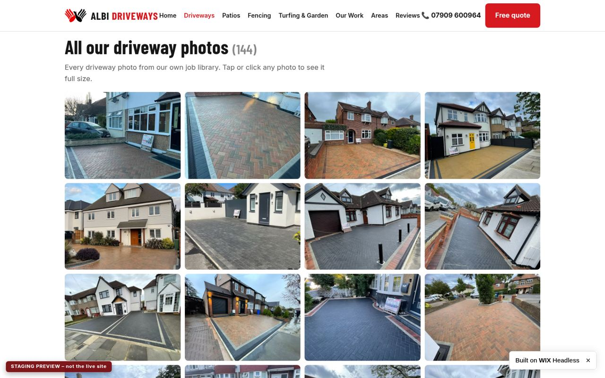

# Albi Driveways – STAGING site

> [!CAUTION]
> **STAGING ONLY. Never connect `albidriveways.com` (or any domain) to this site. Never upload or release to the live site ID `63f40276-7f3c-4d30-aab8-94b92b51ac2e`. Always keep the `noindex, nofollow` meta tag and the "STAGING PREVIEW" ribbon on every page.**

This repo holds the source of the redesigned **Albi Driveways** website (block-paving driveways, patios, fencing, turfing and garden work in Ruislip and North West London). It is a preview, not the live site.

| | |
|---|---|
| Staging URL | https://headless-xbwqxohztxj-albidriveways-140d.wix-site-host.com |
| Staging site ID (metaSiteId) | `a592d588-e67b-470e-a869-50e977b29be2` |
| Dashboard | https://manage.wix.com/dashboard/a592d588-e67b-470e-a869-50e977b29be2 |
| Live site (DO NOT TOUCH) | `63f40276-7f3c-4d30-aab8-94b92b51ac2e` / albidriveways.com |

## What this project is (and is not)

- It is a **plain static HTML site**: 15 pages, one CSS file and one JS file. Every page is generated by one Python script, `src/build.py`, which uses only the Python 3 standard library.
- Images are **not** in the repo. Pages load them from Wix's image CDN (`static.wixstatic.com`), using the live site's Media Manager files and gallery images.
- It is **not** an Astro, Wix CLI or Node project. There is no `package.json`, no `wix.config.json` and no Wix SDK code. The site was put online by creating an empty Wix Headless site, then uploading the built files with the Wix MCP tool `UploadHeadlessWebsiteFiles`.
- The provision call that created the site returned only a `metaSiteId` (`a592d588-…`) and an OAuth client ID, `appId` (`852d5726-6cb9-480c-997e-850cf5c2963c`). It did not create any project files. Both values are public IDs, not secrets. They are listed in `.env.example`.
- The contact form is a **preview only**. Submitting it shows a note and sends nothing.

## Layout

```
src/build.py            the generator: all page copy, layout, SEO tags and schema live here
src/data/media.json     the live site's Media Manager file list (name, URL, size, folder) – read-only input
src/data/photogrid.json the photo grids: category -> list of {id, full URL, alt text}
src/data/categories.json record of how every de-duplicated photo was categorised (id -> category/skip)
src/data/placeholders.json  OUTPUT: every [PLACEHOLDER: …] the build inserted (regenerated each build)
src/linkcheck.py        crawls a running copy and checks links, images, noindex and the ribbon
src/make_bundle.py      packs dist/ into the upload bundle for the Wix MCP tool
templates/assets/       site.css and site.js, copied unchanged into dist/assets/
dist/                   the built site (committed, so it always matches what was last uploaded)
docs/screenshots/       key screenshots of the staging site
```

## Screenshots

`docs/screenshots/`: `home-desktop.jpg` and `home-mobile.jpg` (full page), `grid-driveways.jpg`, `lightbox-open.jpg`, `grid-patios-mobile.jpg` and `lightbox-mobile.jpg`.



## How to edit

**Copy and page structure.** All the text is in `src/build.py`:
- One block per page, marked with a comment such as `# ---------- TURFING`.
- Shared helpers: `hero()`, `sec()`, `faq()`, `cta()`, `review_ph()`, `town()`.
- The site-wide header and footer are in `page()`.

Use UK English. Contact details must stay exactly **07909 600964** and **albidriveways@gmail.com**.

**Styles and the lightbox.** Edit `templates/assets/site.css` and `templates/assets/site.js` (plain JS, no build step). The lightbox supports prev/next, arrow keys, Esc and swipe.

**Photo grids.** `src/data/photogrid.json` has one key per grid:

| Key | Page |
|---|---|
| `drive` | Driveways |
| `patio` | Patios |
| `fence` | Fencing |
| `turf` | Turfing & Garden |
| `brick` | Brickwork |
| `ourwork` | Our Work, "Other job photos" (photos whose category was unclear) |

Current counts: drive: 144, patio: 50, fence: 21, turf: 24, brick: 15, ourwork: 21.

- **Move a photo:** cut its `{…}` object from one list and paste it into another.
- **Remove a photo:** delete its object.
- **Change the order:** reorder the list.
- **Change alt text:** edit `alt`.

How the URLs are used:
- The `full` URL opens in the lightbox.
- The build makes the thumbnail from it: `{full}/v1/fill/w_600,h_450,al_c,q_80,enc_auto/{name}.jpg`.
- `id` is `M###` for a Media Manager file (its position in `media.json`, counted from 0) or `X##` for an image that appears only in a live gallery.

`categories.json` is a record of the first sort; the build does not read it.

**Placeholders.** Anything not yet confirmed by the owner is wrapped as `ph("…")` in `src/build.py`. On the page it shows as a yellow `[PLACEHOLDER: …]` mark. To resolve one, replace the `ph("…")` call with the confirmed text and rebuild. `src/data/placeholders.json` is rewritten with the remaining list on every build. Do not invent facts, prices or reviews.

## Rebuild

```bash
python3 src/build.py          # wipes and regenerates dist/, prints "52 placeholders"
git status                    # shows exactly which built pages changed
```

Needs Python 3.8 or later. There are no dependencies. The build is deterministic: running it twice gives identical `dist/` output.

## Preview locally

```bash
python3 -m http.server -d dist 8080
# open http://localhost:8080/
python3 src/linkcheck.py http://localhost:8080/    # optional: links, images, noindex, ribbon
```

**URL quirk: every internal link ends in `/index.html`.** The Wix host redirects `/driveways/` to `/driveways`, which returns 404. `/driveways/index.html` works. `page()` in `src/build.py` therefore rewrites every internal `href` to an explicit `…/index.html` (the home link is `index.html` on the root page and `../index.html` on inner pages). Keep it that way. Do not "tidy" the links back to folder URLs.

Other host behaviour:
- Wix serves its own auto-generated `robots.txt` (Allow: /) and ignores ours.
- Wix also generates a sitemap.
- The `noindex, nofollow` meta tag on every page is what keeps the staging site out of search results, so **never remove it**.

## Release to STAGING ONLY

### Verified method: the Wix MCP tool `UploadHeadlessWebsiteFiles`

This is how the site has been released every time so far: three successful uploads on 28 and 30 Oct 2026.

1. Rebuild, then pack the **full** site:
   ```bash
   python3 src/build.py
   python3 src/make_bundle.py     # -> build/upload-bundle.txt (all 18 files)
   ```
2. In an agent that has the Wix MCP connector (signed in as the site owner), call `UploadHeadlessWebsiteFiles` with:
   - `siteId`: `a592d588-e67b-470e-a869-50e977b29be2` (staging, and nothing else)
   - `files`: the contents of `build/upload-bundle.txt` (sections starting `=== FILE: <path> ===`)
   - `calledStartDeployWebsite`: `true`, plus an `agentIdentity` and a one-line `reason`. The tool expects `StartDeployWebsite` to have been called earlier in the same conversation, so call that first. It only returns a guide and creates nothing.
3. **Each upload replaces the whole file set.** Always upload the complete `dist/`, never just the changed files, or every missing page disappears from the site. The URL stays the same.
4. Check the result: `python3 src/linkcheck.py https://headless-xbwqxohztxj-albidriveways-140d.wix-site-host.com/`. Expect every page to return 200 and no problems listed. The two fonts.googleapis/gstatic 404s are expected.
5. Ignore any suggestion from the tool to connect or buy a domain.

Docs: https://dev.wix.com/docs/go-headless/wix-managed-headless/other-frameworks/your-own-frontend/skills/upload-a-website-or-html-files

### Wix CLI (`npx wix release`): documented by Wix, NOT set up or tested here

Wix's docs say the CLI can release a static site:
- `wix release` uploads whatever folder `site.outputDirectory` in `wix.config.json` points to.
- It does not build anything.
- A release is limited to 5,000 static files.
- It requires Node 24.22.1 or later and `npx wix login`.

This repo has **no `wix.config.json`**, and this site has never been released with the CLI. Two things to know before trying it:
- `npm create @wix/new@latest init` creates a **new** Wix project. It does not link to the existing staging site. Do not use it.
- For uploaded sites, the docs describe downloading the generated `wix.config.json` from `https://www.wix.com/_api/wixstro-deployments/v1/instant-sites/a592d588-e67b-470e-a869-50e977b29be2/download.zip`. That flow is written for sites created with Wix's Drop uploader, and nobody has confirmed it works for this API-provisioned site.

The docs also say that once you continue in a local tool or the CLI, the dashboard's "Update Site" re-upload is no longer available. Until someone deliberately sets it up and confirms on a test that `siteId` in `wix.config.json` is `a592d588-…`, **use the MCP upload above.**

Wix CLI docs:
- https://dev.wix.com/docs/wix-cli/command-reference/project-commands/release
- https://dev.wix.com/docs/go-headless/wix-managed-headless/other-frameworks/build-and-deploy-with-the-cli
- https://dev.wix.com/docs/go-headless/wix-managed-headless/other-frameworks/the-wix-config-json-file
- https://dev.wix.com/docs/go-headless/wix-managed-headless/other-frameworks/your-own-frontend/upload-a-static-site

> [!WARNING]
> **Never connect albidriveways.com or any other domain. Never upload or release to `63f40276-7f3c-4d30-aab8-94b92b51ac2e` (the live site) or to "My Site 1". Keep `<meta name="robots" content="noindex, nofollow">` on every page.**

## Open placeholders (52)

These need confirming by the owner before any of this content could go live. The list is regenerated in `src/data/placeholders.json` on every build.

1. OPTIONAL PAGE – brickwork is NOT confirmed by the owner. Publish only if Algen confirms brickwork is offered.
2. add a real Google review about a driveway with first name and town
3. add a real Google review about a patio with first name and town
4. add a real Google review about fencing with first name and town
5. add a real Google review about turfing/garden work with first name and town
6. add a real Google review from a Northwood customer with first name and town
7. add a real Google review from a Pinner customer with first name and town
8. add a real Google review from a Ruislip customer with first name and town
9. add a real Google review from an Eastcote customer with first name and town
10. add a real Google review with first name and town
11. add a real local project – captions naming the town (Eastcote) and 2–3 sentences
12. add a real local project – captions naming the town (Northwood) and 2–3 sentences
13. add a real local project – captions naming the town (Pinner) and 2–3 sentences
14. add a real local project – captions naming the town (Ruislip) and 2–3 sentences
15. add a real local project – captions naming the town and 2–3 sentences
16. add more real before/after pairs with town captions
17. confirm
18. confirm 27+ years
19. confirm TPO wording
20. confirm WhatsApp is used on 07909 600964
21. confirm conservation-area wording
22. confirm current Google review count – 160
23. confirm exact scope of garden work offered
24. confirm fence types offered (panels, posts, gravel boards etc.)
25. confirm full list
26. confirm garden clearance is offered
27. confirm gates are offered – remove if not
28. confirm guarantee length and terms
29. confirm how bricks are chosen/matched
30. confirm patio materials offered
31. confirm planning wording
32. confirm postcode lists and that you work in all 11 areas regularly
33. confirm quotes are written
34. confirm range of colours/patterns offered
35. confirm removal/disposal included
36. confirm these steps match how Albi Driveways works
37. confirm typical driveway duration
38. confirm typical fencing duration
39. confirm typical patio duration
40. confirm typical response time, e.g. “within one working day”
41. confirm wall types and heights
42. confirm what help you offer with dropped-kerb applications
43. confirm whether any extra services (resin, tarmac, gravel, dropped kerbs, drainage, brickwork) are offered
44. confirm working hours (directory lists Mon–Sat 8am–6pm)
45. confirm you take on storm repair/replacement call-outs
46. confirm your lawn aftercare advice
47. confirm – e.g. “Yes, we remove and dispose of your old fencing as part of the job.”
48. insurance / accreditations – add only if true (none listed yet)
49. opening hours in LocalBusiness schema (Mon–Sat 08:00–18:00 is a placeholder)
50. optional: embed a map of the service area
51. priceRange "££" in schema – confirm or remove
52. replace the broken Trustmary widget with a working Google reviews embed, or keep hand-picked quotes
